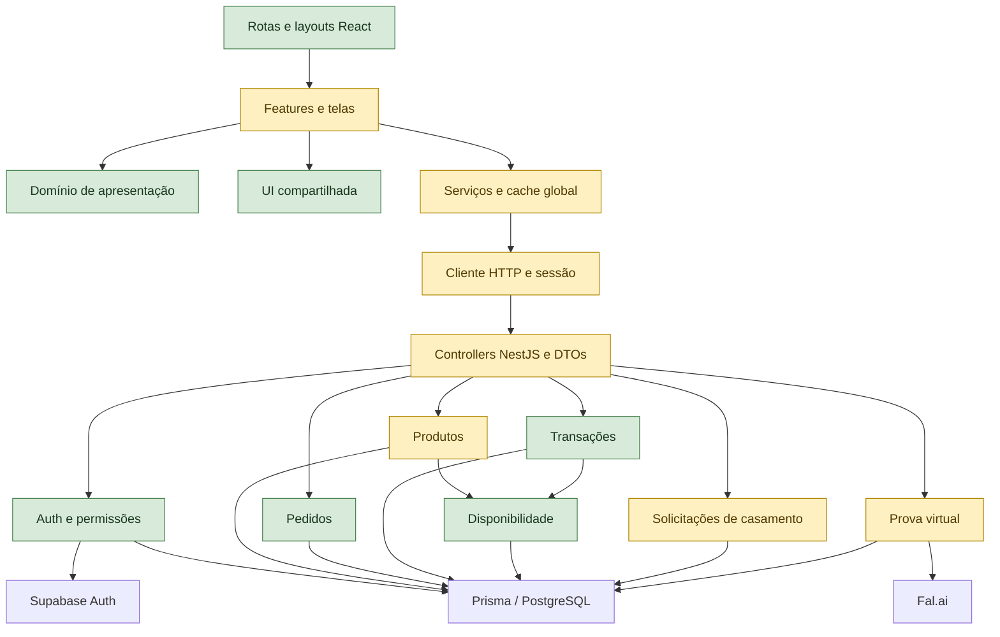

# Auditoria de estrutura e fluxos — 06/10/2026

> **Atualização — etapas 1 a 4 implementadas localmente em 06/10/2026:** os achados 1 a 6 foram corrigidos; o carregamento foi separado por recurso e tela, os testes e a documentação foram atualizados e a marca ganhou alternativa visível quando a imagem falha. A terceira etapa eliminou as consultas por operação no relatório de conflitos e ampliou o typecheck para oito módulos JavaScript e seus contratos. A quarta etapa paginou catálogo, pedidos, histórico de operações e solicitações de pacotes da gestão, com filtros no backend e totais globais. Paginação das demais áreas, cobertura dos demais módulos e desempenho com banco real permanecem pendentes. A homologação com banco e serviços reais foi adiada a pedido do usuário. Os achados e notas abaixo preservam o diagnóstico original; não houve nova auditoria completa nem publicação. Veja os registros de implementação ao final.

**Mode:** Architecture Audit  
**Scope:** frontend `apolorigor` e backend `../apolloapi`; jornadas públicas, acesso, catálogo, pedidos, operações, pacotes e provador. Pagamentos fora do diagnóstico.  
**Health Score:** 59/100 — cálculo heurístico Brooks: 8 Warning × 5 e 1 Suggestion × 1. Não representa percentual de funcionalidades prontas.  
**Trend:** escopo ampliado para dois repositórios; os 89/100 históricos do frontend não são diretamente comparáveis.

A organização do código é boa, mas há falhas reproduzidas na integração e funcionalidades incompletas. É possível apresentar o núcleo de vendas e locações com um roteiro controlado; ainda não é adequado apresentar todo o sistema como operacionalmente concluído.

## Module Dependency Graph



O verificador do frontend analisou 126 módulos sem ciclos ou violações das camadas configuradas. Uma varredura de imports relativos de 56 módulos de produção do backend, excluindo código gerado e testes, também não encontrou ciclos. Isso não certifica ausência de todo acoplamento dinâmico.

## Findings

### Warning

**1. [P1 / R2] O editor não consegue salvar produtos com fotos locais do seed.**  
Symptom: `../apolloapi/scripts/seed-catalog.mjs:20` cadastra `photoUrl` como `/produtos/terno-casamento-marfim.jpg`. `src/features/catalogo/FormularioProdutoGestao.jsx:95` exige `type="url"` e `https://.*`; `../apolloapi/src/modules/products/dto/create-product.dto.ts:49` também exige URL absoluta HTTPS.  
Source: *Software Engineering at Google* — Backward compatibility; *A Philosophy of Software Design* — Information Leakage.  
Consequence: abrir um desses produtos, alterar apenas o nome ou estoque e salvar é bloqueado pela validação do campo Foto. Contornar o HTML não resolve a divergência com o DTO.  
Remedy: definir um contrato único para imagens; suportar caminhos locais controlados ou migrar os dados do seed para URLs HTTPS. Cobrir edição de um produto real originado do seed.  
Evidência: reproduzido em Edge; nenhum PATCH foi emitido. A validação do DTO compilado rejeitou o mesmo endereço.

**2. [P1 / R2] Pedidos e andamento ficam desatualizados entre cliente e equipe.**  
Symptom: `src/app/ApiConnection.jsx:16` carrega dados quando a sessão muda; a navegação entre telas não refaz a consulta. Serviços atualizam o cache após ações nesta instância, sem atualização por foco, prazo ou eventos de outra sessão.  
Source: *A Philosophy of Software Design* — Information Hiding; *Software Engineering at Google* — Observable behavior.  
Consequence: um administrador já conectado pode não enxergar uma solicitação recém-enviada pelo cliente; o cliente pode continuar vendo o estado anterior após aprovação. Trocar de tela não resolve.  
Remedy: estabelecer atualização por recurso ao entrar/retomar a tela, um botão explícito de atualização e, se necessário, consulta periódica.  
Evidência: acrescentei um pedido à API simulada depois do carregamento, naveguei Dashboard → Pedidos e a lista continuou vazia sem novo GET. Recarregar a página mostrou o pedido.

**3. [P1 / R3] O rascunho enviado continua na memória e permite pedido duplicado.**  
Symptom: `src/features/pedidos/usePedidoForm.js:42` registra sucesso e apaga sessionStorage, mas não limpa o estado `rascunho` pertencente a `src/layouts/SiteLayout.jsx:23`.  
Source: *The Pragmatic Programmer* — DRY; *Domain-Driven Design* — Invariant ownership.  
Consequence: enviar pedido → Voltar ao início → Voltar do navegador restaura o formulário já enviado. Um novo clique envia outro POST. O backend cria um novo protocolo a cada criação.  
Remedy: centralizar o descarte do rascunho e limpar memória e armazenamento no sucesso. Para reenvios após falha de rede, considerar também idempotência no endpoint.  
Evidência: reproduzido no navegador, com dois POSTs e armazenamento já vazio após o primeiro.

**4. [P1 / R2] O contrato de datas dos pacotes diverge dos demais fluxos.**  
Symptom: `../apolloapi/src/common/interceptors/dates.interceptor.ts:11` serializa apenas `startDate` e `endDate` como dia; `eventDate` sai como timestamp. `src/features/locacoes/PacoteVisaoGeral.jsx:24` envia esse timestamp para `fmtDate`, que acrescenta `T12:00:00` (`src/shared/lib/format.js:5`). O DTO de pacote valida a data somente como string de até dez caracteres (`../apolloapi/src/modules/wedding-packages/dto/create-wedding-package.dto.ts:26`).  
Source: *Code Complete* — Defensive programming; *A Philosophy of Software Design* — Information Leakage.  
Consequence: uma data válida aparece como `Invalid Date` na gestão. Entradas inválidas podem chegar ao Prisma e virar erro interno; dias inexistentes podem ser normalizados para outro dia.  
Remedy: reutilizar a validação estrita de dia do backend, definir a política para datas passadas e serializar `eventDate` como `YYYY-MM-DD`.  
Evidência: reprodução visual com `2026-11-15T00:00:00.000Z`; validação direta aceitou `banana`, `2026-02-31` e `2020-01-01`. Serviço exercitado com repositório falso, sem gravar banco; `banana` produziu objeto Date inválido.

**5. [P2 / R2] Apagar campos opcionais do catálogo não apaga os valores salvos.**  
Symptom: `src/data/adapters.js:109` omite `foto`, `cor`, `tecido`, `linha` e `colecao` quando vazios. O PATCH do servidor preserva campos omitidos; os DTOs atuais também não oferecem um contrato de limpeza compatível.  
Source: *Software Engineering at Google* — API contracts.  
Consequence: apagar um desses campos e salvar pode aparentar sucesso, mas o valor antigo retorna.  
Remedy: distinguir campo não alterado de remoção intencional e suportar essa remoção no DTO, persistência e formulário.  
Evidência: execução do adaptador com campos vazios confirmou que nenhum deles entra no payload; comportamento de update conferido no serviço.

**6. [P2 / R6] Textos públicos e de acompanhamento contradizem o fluxo implementado.**  
Symptom: `src/features/inicio/InicioProvador.jsx` afirma que IA não está disponível, mas `PreviaProvador.jsx` oferece geração e envia arquivos à Fal.ai mediante consentimento. `CapturaFoto.jsx:158` afirma que a foto fica somente na página sem contextualizar esse envio posterior. `conteudoInicio.js` sugere reserva já no pedido, enquanto o estoque só é comprometido na confirmação da transação. `RastreioPedido.jsx` continua dizendo “aguarda confirmação” para pedido aprovado mesmo quando a transação já foi concluída ou cancelada.  
Source: *Domain-Driven Design* — Ubiquitous Language; *The Mythical Man-Month* — Conceptual Integrity.  
Consequence: a apresentação transmite capacidades e etapas incompatíveis. A conta pode mostrar um rastreio aguardando confirmação junto de uma operação concluída.  
Remedy: alinhar os textos ao comportamento real e derivar a mensagem de acompanhamento também da transação relacionada. Explicar que a foto permanece local até autorização de envio. Não afirmar que IA está operacional sem verificar configuração e geração real.

**7. [P2 / R5] A falha de uma consulta bloqueia áreas independentes.**  
Symptom: `src/data/cache.js:44` carrega catálogo, pedidos, transações, perfis e conflitos em um único `Promise.all`; `DataBoundary` depende de uma única inicialização global. As listas são carregadas por inteiro, mesmo em telas que usam um único recurso.  
Source: *The Pragmatic Programmer* — Orthogonality; *Clean Architecture* — Dependency boundaries.  
Consequence: na primeira carga administrativa, falhar o relatório de conflitos pode impedir até abrir o editor de catálogo. O tempo de entrada cresce com todo o histórico. `readConflicts` também consulta disponibilidade repetidamente por operação.  
Remedy: separar carregamento/erro por recurso, paginar as telas e carregar relatórios conforme necessário. Agrupar consultas de conflito por variante. A escala não foi medida com banco real.

**8. [P2 / R2] Testes e documentação ainda descrevem a versão anterior.**  
Symptom: `tests/e2e/restored-interfaces.spec.js` exige botões de pacotes desabilitados; `tests/e2e/provador.spec.js` busca “Ver prévia de demonstração”, texto substituído. `tests/helpers/api.js` não simula os novos endpoints de pacotes e IA. README/PRODUCT ainda negam conexões presentes no código. `tsconfig.json` verifica apenas uma declaração de domínio e `status.js`.  
Source: *Software Engineering at Google* — Code sustainability; *How Google Tests Software* — Risk-based testing.  
Consequence: a suíte não fica verde e não garante os fluxos recém-integrados. “Typecheck passou” não significa que todo o frontend foi verificado.  
Remedy: atualizar contratos de teste e documentação; cobrir envio/listagem de pacotes, datas, consentimento, falha/sucesso de IA e as reproduções desta auditoria. Ampliar a checagem de tipos gradualmente.

### Suggestion

**9. [P2 / R5] A marca desaparece quando a imagem externa falha.**  
Symptom: `src/shared/ui/estrutura/BrandLogo.jsx:1` depende de um domínio externo; o `onError` na linha 11 oculta a imagem sem alternativa visível.  
Source: *Code Complete* — Defensive programming.  
Consequence: nas capturas desta execução, cabeçalho e sidebar ficaram sem logotipo. Isso não comprova indisponibilidade permanente do domínio, mas comprova ausência de fallback.  
Remedy: disponibilizar um arquivo de marca aprovado no próprio site e manter alternativa textual em falhas.

## Funcionalidades presentes, mas ainda incompletas

| Fluxo | Estado observado |
| --- | --- |
| Cadastro, login, recuperação, perfil | Frontend e endpoints conectados; testes HTTP simulados aprovados. Envio real de e-mail/Supabase não exercitado. |
| Catálogo, tamanho e disponibilidade | Conectados. Consulta por período e bloqueio de indisponibilidade exercitados no frontend. Corrigir a edição das fotos do seed. |
| Pedido individual | Criação, análise, aprovação e recusa conectadas. Corrigir rascunho e atualização entre sessões. Não é carrinho de múltiplos itens: cada pedido tem uma variante. |
| Venda/locação | Aprovação cria rascunho; confirmação compromete estoque; retirada, entrega, devolução e cancelamento estão implementados. Jornada do frontend exercitada com mocks. |
| Agenda e dashboard | Baseados nas operações da API; componentes responsivos e temas verificados. Relatórios não homologados com banco real. |
| Pacotes de casamento | POST público persiste solicitação e participantes; GET administrativo lista. Só existem essas duas rotas: não há atualização de status, edição ou ciclo comercial do grupo. O cadastro não preenche `profileId`. |
| Portal “Meu casamento” | Renderiza estrutura vazia (`<PortalNoivo />`) sem consultar o pacote enviado. Não demonstra acompanhamento real do casal. |
| Costura/ajustes | Painel explicitamente indisponível, botão “Nova ordem de ajuste” desabilitado; sem endpoint/modelo operacional de costura. Retiradas e devoluções são outro fluxo e estão conectadas. |
| Provador | Upload/preparação local funcionaram nos testes. Geração possui frontend e endpoint Fal.ai; geração real não executada. Depende de FAL_KEY e de a foto do traje poder ser obtida por fetch no navegador. URLs HTTPS cadastráveis não garantem CORS nem formato compatível. |

As lacunas de pacotes/portal/costura são limites de escopo do produto atual, não tratadas como falhas novas de uma funcionalidade que já estava pronta. Devem ser apresentadas como próximas entregas.

## Verificação executada e seus limites

- Frontend: **20/20 testes unitários**, lint, build e `check:architecture` passaram. Typecheck passou com o escopo restrito descrito acima.
- Backend: geração do Prisma e compilação NestJS passaram. Nenhuma migration, seed ou escrita no banco foi executada.
- Suíte de navegador existente: 48 casos previstos; execução chegou a 47, com **6 falhas** e limite de falhas atingido. Cinco falhas foram expectativas antigas de pacotes/provador; uma foi desconexão da câmera simulada antes da captura. O último caso não executou. O processo permaneceu aberto após anunciar a interrupção e foi encerrado; não houve um resumo final normal do runner.
- Os demais 41 casos chegaram ao próximo caso sem registrar falha, incluindo contratos HTTP, autenticação simulada, pedidos, administração, foco de diálogo, temas e layouts de 390, 768, 1024 e 1440 px. São evidências com API simulada, não homologação front + backend + banco.
- **4/4 reproduções adicionais passaram**, confirmando os problemas de cache, rascunho, data e foto do seed. Scripts locais: `.validation.local/audit.spec.mjs` e `.validation.local/audit.config.mjs`. Nesses testes, “passar” significa reproduzir o defeito esperado.
- Validação de datas e de photoUrl executada também contra DTOs compilados do backend; a reprodução do serviço de pacotes usou um substituto de Prisma, sem banco.
- Vitest e oxlint do backend não iniciaram: o Windows bloqueou bindings nativos. A tentativa de instalar alternativas WASM sem alterar manifestos não concluiu porque o pacote alternativo de oxlint retornou 404. Não classifico isso como falha da aplicação.
- O Node local é 24.14.0; dependências do CLI Nest instalado avisaram requisito de 24.15.0 ou outra linha compatível. O build ainda assim passou neste ambiente.
- Não havia configuração local completa de execução nem conta de teste fornecida. Banco, e-mails reais, CORS de implantação, geração Fal.ai e concorrência real permanecem sem homologação. Nenhuma chamada paga de IA foi feita.
- Capturas de catálogo/dashboard foram inspecionadas em desktop e mobile. As imagens de produtos nos testes são substitutas; isso não valida a fotografia do catálogo real. Câmera física e gestos em dispositivo real não foram testados.
- Código de produção e manifestos não foram alterados. Foram instaladas dependências, gerados builds/artefatos locais de verificação e escrito este relatório.

## Auditoria de interface

**Implementation Integrity Verdict:** identidade e estrutura visual coerentes; experiência ainda contém inconsistências de estado e comunicação. Não aprovada como fluxo integralmente concluído.

| Dimensão | Nota provisória | Evidência / limite |
| --- | --- | --- |
| Acessibilidade | 3/4 | Formulários rotulados, foco visível e diálogo com contenção/restauração testada; sem certificação integral de contraste/leitor de tela. |
| Performance | 2/4 | Rotas lazy e bundle principal de cerca de 76 kB gzip; carga global de todas as listas e consultas repetidas de conflitos. Sem medição de produção. |
| Responsividade | 3/4 | Casos de 390–1440 px nos dois temas sem falhas reportadas; sem dispositivo físico. |
| Temas | 3/4 | Tokens e temas consistentes nas capturas e testes; logotipo sem fallback visível. |
| Integridade | 2/4 | Contradições de texto, cache desatualizado e contratos divergentes. |
| Total | **13/20** | Avaliação parcial: funcionamento visual razoável, correções relevantes antes da apresentação completa. |

O detector Impeccable não executou por ausência do componente local. Essas notas são da inspeção de código/capturas e testes, não de uma varredura automática completa.

## Estrutura, testabilidade e pontos positivos

As páginas compõem features; adaptadores centralizam a tradução de UUIDs, centavos e estados; regras de estoque permanecem no backend. Rotas administrativas têm proteção de servidor, e consultas de pedidos/transações são filtradas pelo dono. O banco usa transações Serializable com repetição para conflitos e a disponibilidade contabiliza sobreposição temporal, incluindo devoluções atrasadas.

O Nest permite substituir Prisma e serviços por injeção; os testes existentes usam essas fronteiras. O frontend possui funções de domínio puras e interceptação HTTP nos testes. Fal.ai é acessada por um singleton importado diretamente: um adapter injetável facilitaria validar geração sem rede, mas não é necessário reorganizar todo o backend por isso.

R1/R4: não identifiquei evidência suficiente para apontar tamanho de funções ou abstrações como problema prioritário. Não recomendo microserviços ou reescrita. A estrutura de equipes é desconhecida, portanto a análise de Conway foi omitida.

## Summary

Antes da reunião, priorizar edição dos produtos do seed, limpeza do rascunho, atualização de dados entre sessões e datas de pacotes. Alinhar os textos e a suíte ao comportamento atual. No roteiro, mostrar catálogo → login → pedido → análise → rascunho → confirmação → retirada/devolução, distinguindo claramente solicitação de pacote, portal em construção e costura indisponível.

Para declarar o sistema pronto de ponta a ponta, ainda falta executar essa jornada com backend, banco e contas de teste reais. Para UI, as correções correspondem a `$impeccable harden` (estados/contratos), `$impeccable clarify` (textos) e, ao final, `$impeccable polish`. Os contatos, endereço, horários e promessa de ajustes inclusos também precisam ser confirmados pela empresa; a auditoria não comprova esses fatos comerciais.

## Implementação — primeira etapa

Concluída localmente em **06/10/2026**, após autorização para começar a primeira etapa. Foram tratados os quatro achados P1; pagamentos e as funcionalidades futuras de pacotes/portal/costura não foram alterados.

| Achado | Correção | Verificação |
| --- | --- | --- |
| 1 — edição das fotos locais | Formulário e DTO aceitam imagens em `/produtos/`, incluindo `feminino`, nomes do seed com espaços codificados e URLs HTTPS. Caminhos fora da pasta, travessia de diretórios e esquemas incompatíveis são recusados. | Teste de navegador salvou nome com a foto local preservada; testes de DTO cobrem criação/edição e entradas recusadas. |
| 2 — atualização entre sessões | Reconsulta ao navegar, retomar foco/visibilidade e a cada 30 segundos para usuários autenticados em abas visíveis; botão Atualizar dados na conta e gestão. Reconsultas periódicas não interrompem consultas em andamento. | Navegação mostrou pedido criado externamente; botão/foco atualizaram estado do cliente; teste com relógio controlado verificou consulta periódica e pausa em aba oculta. |
| 3 — rascunho duplicado | O layout, dono do rascunho, limpa memória e sessionStorage no sucesso. O formulário não envia sem rascunho ou depois de concluído. Erros preservam os dados. | Voltar pelo histórico após sucesso abre a orientação para escolher um traje, sem segundo POST. Falha de envio mantém o rascunho, inclusive após recarregar. |
| 4 — datas de pacote | DTO exige dia ISO válido; serviço reutiliza `parseDay` e rejeita datas anteriores ao dia comercial de São Paulo. `eventDate` é serializado como `YYYY-MM-DD`. Frontend mantém compatibilidade de exibição com timestamps antigos. | Testes HTTP recusaram datas inválidas/passadas/null sem gravação e verificaram respostas de criação/listagem. Navegador mostrou 15/11/2026 nos dois formatos de resposta. |

**Resultados desta etapa:**

- **22/22 testes unitários do frontend aprovados.**
- **26/26 testes de navegador aprovados:** 14 de integração existente, 8 novas regressões e 4 casos de responsividade (390, 768, 1024 e 1440 px, temas claro/escuro).
- **2/2 testes de contratos do backend aprovados**, com múltiplas entradas por caso. Utilizam o runner nativo do Node e incluem validação HTTP real do Nest com Prisma substituído; não dependem dos bindings do Vitest.
- Builds de frontend/backend, lint e typecheck do frontend aprovados. Escopo restrito do typecheck permanece como registrado na auditoria.
- Verificação de arquitetura: 127 módulos do frontend, sem ciclos ou violações detectadas.
- Capturas de catálogo administrativo em mobile e desktop inspecionadas após a inclusão do botão de atualização.
- O encerramento automático do preview ficou pendente no Windows. Após encerrar especificamente o processo de preview iniciado pelos testes, o Playwright finalizou normalmente com código 0 e resumo `26 passed`.

**Comandos para repetir:**

Frontend:

```text
npm run lint
npm run typecheck
npm run check:architecture
npm test
npm run build
npm run test:e2e -- tests/e2e/flow-regressions.spec.js tests/e2e/api-integration.spec.js tests/e2e/responsive.spec.js
```

Backend (`apolloapi`):

```text
npm run build
npm run test:contracts
```

**Limites que permanecem:** não houve acesso ao banco real, migrations, seed, geração de IA ou publicação. A atualização entre sessões ocorre por consulta, não em tempo real. A correção de duplicação cobre o rascunho e o histórico do navegador; idempotência de POST em caso de resposta perdida continua fora desta etapa. A divisão do cache por recurso, demais achados P2 e testes antigos de pacotes/provador continuam pendentes. O frontend tolera datas da versão anterior, mas a edição de fotos locais exige implantar também o backend atualizado.

## Implementação — segunda etapa

Executada em **06/10/2026**, após o usuário adiar a homologação com banco real e autorizar avançar para a próxima etapa. O registro da primeira etapa acima descreve o estado daquele momento; as pendências tratadas agora estão discriminadas abaixo.

| Achado | Resultado desta etapa | Evidência |
| --- | --- | --- |
| 5 — limpar opcionais do catálogo | PATCH envia `null` ao apagar coleção, tecido, cor, linha e foto. DTO aceita `null` apenas nesses campos; omissão preserva o valor, criação e obrigatórios mantêm as validações. | Navegador salva, recarrega e reabre campos vazios. Testes Nest verificam validação e passagem pelo controller/serviço até a persistência substituída. |
| 6 — textos e estados | Home informa prévia opcional com IA e autorização; captura esclarece quando há envio. Pedido não promete reserva antes da confirmação. Rastreio distingue rascunho, confirmação, retirada, conclusão e cancelamento da operação. | Testes unitários dos estados e navegador com transação atualizada após aprovação. |
| 7 — falhas acopladas | Cache publica dados, carregamento e erros por recurso. Cada rota consulta suas dependências; contador de pedidos da gestão carrega separadamente. Estoque e perfil funcionam sem relatórios/transações. Pacotes entram no ciclo de atualização manual e periódica. | Falha de relatório seguida de navegação para estoque; perfil sem consultas comerciais; resposta lenta não impede publicar catálogo; resposta de sessão encerrada é descartada. |
| 8 — testes e documentação | Expectativas de pacotes/provador atualizadas. Mocks suportam solicitação com participantes e multipart de geração. README dos dois projetos e PRODUCT.md descrevem integração e limites atuais. | Testes de sucesso/erro, formulário preservado, consentimento antes do upload e solicitação sem criação de reserva. |
| 9 — marca desaparecendo | Falha do JPG externo mostra o nome Apollo Rigor, com nome acessível, no mesmo espaço da marca. | Teste força falha da imagem e verifica alternativa visível. A imagem original ainda depende do domínio externo. |

**Verificação:** frontend com **26/26 testes unitários**, lint, typecheck no escopo restrito, build e arquitetura (**129 módulos**, sem ciclos) aprovados. A execução completa do navegador teve 65 aprovados em 66, com um seletor incorreto no teste novo do perfil (`Nome` em vez de `Nome completo`). Após a correção, a reexecução das duas suítes afetadas passou **24/24**, incluindo o perfil; nenhum caso permanece falhando nessas execuções. Não foi necessário repetir as demais suítes. Os cenários cobrem temas e larguras de 390 a 1440 px; capturas de estoque móvel e convite ao provador em desktop foram inspecionadas. Fotografias nos testes são substitutas.

Backend: compilação aprovada e **4/4 testes de contrato** aprovados via `npm run test:contracts`, com DTOs reais e HTTP Nest usando persistência substituída. Vitest/oxlint continuam sujeitos ao bloqueio de bindings nativos do Windows identificado na auditoria; não foram declarados aprovados. Nenhum banco, migration, seed, e-mail real ou geração paga foi usado.

**Pendências mantidas:** homologação real de autenticação, banco, e-mails, CORS e Fal.ai; câmera física; paginação na interface, redução das consultas repetidas de conflitos e medição com volume real; ampliação de TypeScript além dos dois arquivos atuais; portal individual de casamento e fluxo de costura. Confirmar com a empresa endereço, contatos, horários e a promessa de ajustes inclusos antes da apresentação. Essas pendências impedem declarar o sistema integralmente homologado, embora as correções locais desta etapa estejam verificadas.

Para disponibilizar a limpeza dos opcionais, publicar também o backend atualizado: o contrato anterior rejeita `null`. Nenhuma publicação foi realizada nesta etapa.

## Implementação — terceira etapa

Concluída localmente em **06/10/2026**, com foco em reduzir consultas repetidas e ampliar a verificação estática, após autorização para avançar. As etapas anteriores permanecem documentadas como histórico.

**Backend:** `TransactionsService.readConflicts` carrega locações confirmadas e quantidades das variantes em uma chamada `findMany`, agrupa as reservas por variante e reutiliza `occupancy`. Foram removidas as buscas de variante e reservas para cada operação avaliada, além do carregamento de pagamentos e dados completos dos produtos nesse relatório. O dia comercial é calculado uma vez por execução. Regras de confirmação, reserva e pagamento não foram alteradas.

Os testes verificam equivalência com `StockService`, sobreposição inclusiva, atraso com retirada, ausência de retirada, capacidade suficiente, variantes independentes e propagação de falha de leitura. Com **1.200 reservas controladas**, o relatório executa **uma chamada de listagem**, sem acesso adicional por reserva. Isso não mede SQLs internos do Prisma, latência real ou concorrência do banco. O cálculo de ocupação ainda percorre as reservas da variante para cada intervalo.

**Frontend:** o typecheck passou de um módulo JavaScript e uma declaração para **oito módulos JavaScript e duas declarações**, além de um arquivo de testes de tipos. Abrange adaptadores da API, dependências das rotas, rastreio, provador, datas, formatação, imagens e estados visuais. Os contratos distinguem UUIDs, centavos numéricos, estados e campos opcionais que aceitam limpeza. Asserções de compilação verificam que combinações inválidas continuam rejeitadas. Foram tratados explicitamente erros de câmera de tipo desconhecido e ausência de uma parte da data retornada por `Intl`.

**Validação:** frontend com **26/26 testes unitários**, **31/31 testes de navegador selecionados** (integração, regressões da segunda etapa e provador), lint, typecheck ampliado, build e arquitetura de 129 módulos aprovados. Backend com build e **6/6 testes de contrato** aprovados, sem banco ou serviços externos. Os testes de navegador usam API substituída; a verificação de tipos não valida respostas HTTP durante a execução nem cobre integralmente componentes React, cache ou cliente HTTP. Vitest e oxlint do backend não foram declarados aprovados.

**Próximas pendências:** paginação das listas na interface e nas consultas correspondentes; expansão da cobertura de tipos para os módulos restantes; medição e homologação com banco, autenticação, e-mails, CORS, câmera física e Fal.ai reais. Portal individual de casamento e ordens de costura continuam como funcionalidades futuras. Endereço, contatos, horários e condições comerciais dependem da confirmação da empresa. Não houve publicação, migration ou seed.

## Implementação — quarta etapa

Concluída localmente em **06/10/2026**, após autorização para avançar e continuar. Escopo: as quatro listas principais da gestão, preservando os fluxos que dependem de coleções completas.

| Lista | Comportamento implementado |
| --- | --- |
| Catálogo e estoque | 20 modelos por página; busca por nome, cor e categoria e filtro de situação no servidor. Resumo mantém modelos ativos/inativos e peças de todo o acervo. |
| Pedidos | 20 pedidos por página e filtro por status no servidor. Contagens por status são globais; detalhe permanece aberto após marcar em análise, mesmo quando o pedido sai do filtro atual. |
| Histórico de operações | 20 operações por página; busca por modelo ou cliente no servidor. Nome do cliente vem junto de cada operação. Atualização da mesma página preserva o formulário de devolução aberto. |
| Solicitações de pacotes | 20 solicitações por página. A API ajusta páginas que deixaram de existir após mudanças na lista. |

Os novos endpoints retornam registros e metadados de paginação. Ordenação usa data de criação e ID como desempate. Contagens e página são consultadas em transação com isolamento RepeatableRead; o funcionamento desse isolamento no PostgreSQL ainda depende da homologação real. As rotas de catálogo administrativo e pacotes exigem administrador; pedidos, operações e resumo preservam o filtro por usuário. Parâmetros de página, limite e filtros passam por DTOs. Endpoints anteriores continuam compatíveis, retornando arrays.

Na interface, filtros e página ficam na URL, com retorno à primeira página ao filtrar e suporte a recarregamento/Voltar. O contador lateral usa um resumo, sem baixar todos os pedidos. Cache diferencia páginas e listas completas, descarta respostas atrasadas e evita que uma página parcial alimente os totais do dashboard. Falha de troca de página oculta os registros da página anterior e oferece nova tentativa. Os controles foram inspecionados em 390 px nos dois temas.

**Validação:** **29/29 testes unitários do frontend**, **7/7 contratos do backend**, lint, typecheck, builds e arquitetura de **131 módulos** aprovados. O novo contrato HTTP usa controllers, serviços, DTOs e guarda de autenticação reais, com persistência e autenticação substituídas; cobre 401/403, escopo do cliente, filtros, totais, desempate, página vazia/fora do intervalo e rejeição de parâmetros inválidos antes de consultar dados.

A primeira execução completa do navegador teve 65 aprovados em 66. O teste restante voltava antes de a home terminar de montar; foi sincronizado com a navegação concluída. Após os ajustes, **21/21 testes de navegador selecionados** passaram: nove cenários de paginação e doze regressões de pedidos/operações. Cenários com 21–45 registros verificam quantidade de requisições, filtros além da primeira página, histórico, atualização, redução da lista, erro/retry e isolamento do cache. Não foram feitos testes com banco real nem chamadas externas pagas.

**Pendências e implantação:** publicar o backend com os novos endpoints antes deste frontend. Dashboard, agenda, retiradas/devoluções, seletores, vitrine e conta do cliente ainda usam listagens completas; paginação/agregações específicas dessas áreas e medição de consultas com volume real permanecem pendentes. Homologação de serviços reais e funcionalidades futuras já descritas nas etapas anteriores continuam fora desta entrega. Não houve publicação, migration ou seed.


## Implementação — quinta etapa (07/10/2026)

O usuário solicitou as três melhorias de código restantes e, depois, adiou explicitamente a aplicação da migration e a publicação. Esta etapa cobre implementação e verificação local. As pendências históricas de paginação e idempotência das etapas anteriores são atualizadas por este registro.

| Área | Resultado |
| --- | --- |
| Vitrine e provador | Páginas de 20 modelos; categoria e ocasião filtradas no servidor. A home solicita seis destaques. Detalhes usam o ID, inclusive fora da página carregada. |
| Conta do cliente | Pedidos e operações têm páginas independentes. Protocolos antigos são resolvidos no servidor dentro do escopo da conta. |
| Retiradas/devoluções | Filtro de locações confirmadas no servidor, páginas de 20 operações e total global de atrasos. |
| Formulários | Seletores paginados de clientes e modelos, busca remota, seleção preservada durante a busca e recuperação de falhas. |
| Dashboard | Agregações globais de acervo, valores e filas; somente cinco próximas movimentações no resultado. |
| Agenda | Totais diários agregados no servidor em janelas de até 42 dias, separados dos detalhes paginados. Totais não são calculados apenas sobre a página atual. |
| Conflitos | Uma leitura de reservas; intervalos sobrecarregados calculados uma vez por variante, com busca binária por reserva, evitando recalcular toda a ocupação para cada registro. |
| Tipos | CheckJs estrito ampliado de 8 para 17 módulos JavaScript, cobrindo todos os módulos de domínio, navegação, calendário e persistência da tentativa, além do escopo anterior. Asserções negativas verificam quantidades, datas e modalidades inválidas. |
| Idempotência | Chave UUID por rascunho e corpo da tentativa preservado por conta na aba. Repetição recupera o pedido original; chave com corpo diferente recebe 409. Índice único por conta/chave protege a persistência; o serviço recupera o vencedor após uma colisão concorrente. |

As telas atuais não dependem das listagens completas antigas. Os endpoints legados continuam disponíveis. Consultas auxiliares descartam respostas de rota/conta anterior, permitem nova tentativa e atualizam ao retomar a aba; consultas autenticadas também renovam a cada 30 segundos enquanto visíveis.

**Verificação local:** frontend com 31 testes unitários aprovados, lint, typecheck estrito, arquitetura de 134 módulos sem ciclos e build aprovados. Backend com build e 12 testes de contrato aprovados. A primeira rodada de navegador teve 74/80 aprovados: foram corrigidas expectativas antigas de endpoints, seletores dos testes novos e identificação dos controles de paginação. Na rodada completa com o build final, 77/81 passaram; os quatro restantes eram seletores de testes antigos que passaram a encontrar também a navegação dos seletores paginados. Após restringi-los ao papel combobox, as três suítes afetadas passaram 20/20, incluindo os quatro casos. Nenhum caso permanece falhando nas execuções finais; não se trata de uma única execução 81/81. Os seis cenários novos de escala/recuperação passaram na rodada completa, incluindo resposta perdida, recarga, modelo desativado, páginas independentes, busca além da primeira página, totais diários globais e recuperação de falha do seletor. Captura do formulário de casamento em 390 px foi inspecionada, sem corte horizontal.

**Limites da verificação:** contratos usam Nest e regras reais com persistência/autenticação substituídas; o navegador usa API simulada. O teste de concorrência exercita a recuperação de violação única simulada, não duas transações reais. Agregação SQL, índices e isolamento no PostgreSQL real dependem da homologação adiada. A compilação cobre o backend, mas a execução de Vitest/oxlint não foi declarada aprovada nesta etapa devido ao bloqueio nativo já registrado.

**Banco e publicação:** a migration 20261006000000_order_idempotency está preparada e NÃO foi aplicada. Não houve seed, recriação de banco ou deploy. Quando o usuário decidir publicar, a ordem é aplicar a migration, publicar o backend e publicar o frontend, seguida da conferência no ambiente. A idempotência persistente exige o índice da migration. Portal individual de casamento, costura e demais itens fora do escopo atual não são declarados implementados.
